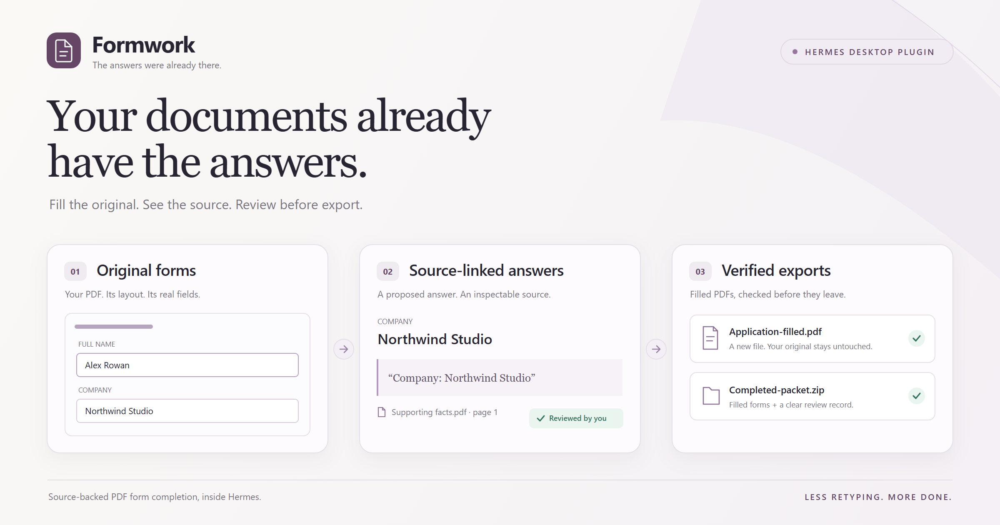
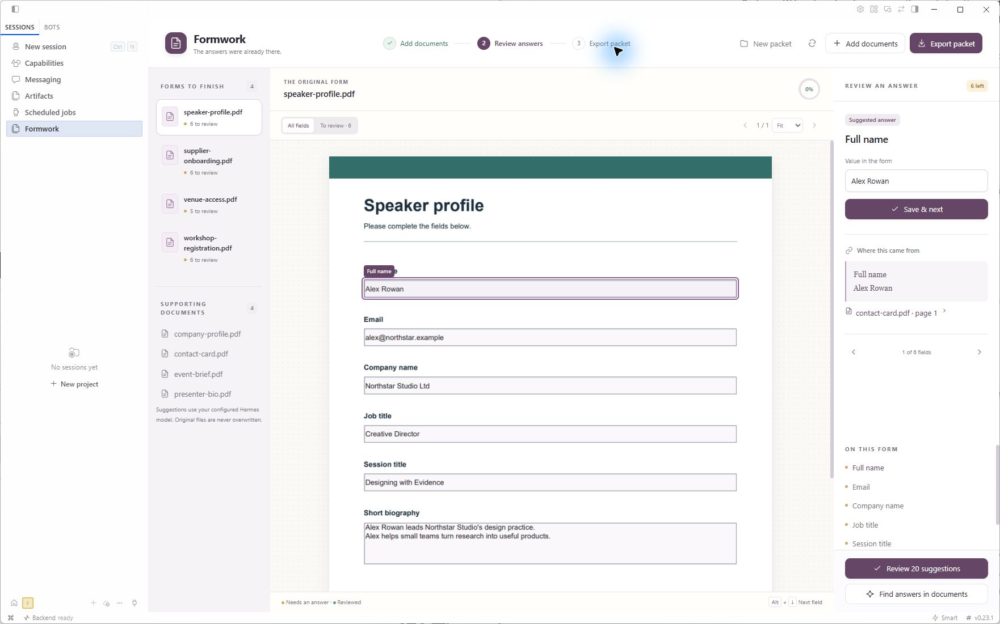
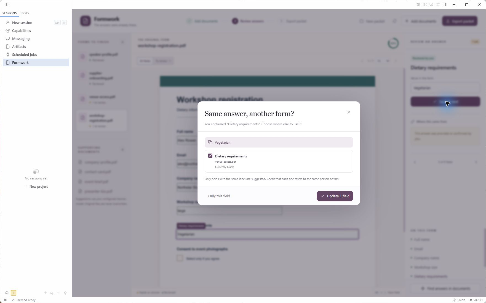
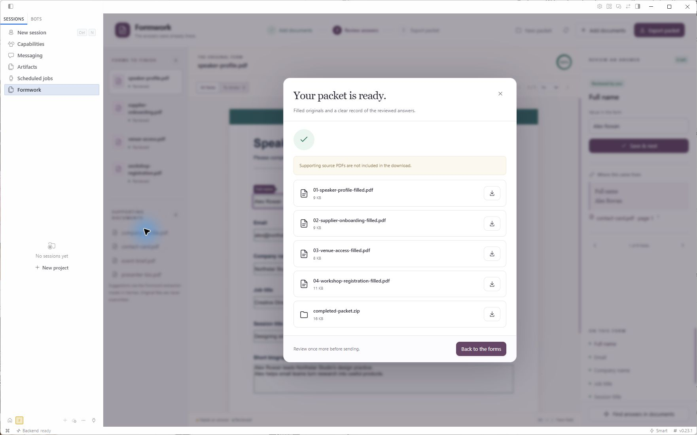

# Formwork



Complete a packet of PDF forms from the documents you already have, with the evidence beside each suggested answer.

Formwork adds a native workspace to Hermes Desktop: review answers on the original pages, confirm where they came from, reuse a missing fact across matching fields, and save filled, editable copies.

**0.1.0 · [MIT](LICENSE) · Hermes 0.23.1+ · Verified on Windows**

## Install

Install from the [public repository](https://github.com/ladyFaye1998/hermes-formwork) into the Hermes profile you want to use:

```sh
hermes plugins install https://github.com/ladyFaye1998/hermes-formwork --enable
```

Approve the declared Python dependencies when Hermes asks. In Desktop, open **Capabilities → Plugins**, enable Formwork's Desktop contribution, and choose **Formwork** in the sidebar. The Python plugin must also be enabled for the active profile; the command above requests that enablement.

In **Settings → Models → Auxiliary**, select **Formwork extraction** and choose an image-capable model. This slot follows Hermes's **Vision** configuration until you give it its own model. Extraction sends rendered form pages as well as text, so a text-only model is insufficient. The verified native demonstration used Nous Portal with `openai/gpt-6.1-sol`; the plugin does not require that particular provider.

See Hermes's [plugin installation guide](https://hermes-agent.nousresearch.com/docs/user-guide/features/plugins) for profile selection and dependency consent.

## Use

1. **Add documents.** Select fillable PDF forms and supporting PDFs with extractable text. Formwork separates forms from supporting documents.
2. **Find answers in documents.** Hermes proposes values with a supporting source page and quote. Imported files are preserved.
3. **Review the answers.** Select a field on the original page, inspect its evidence, and use **Save & next**. You can also open **Review suggestions** to inspect and approve selected sourced answers together. Conflicting answers stay unresolved until you choose.
4. **Answer what is missing.** Enter facts that the documents do not contain. When another form has a matching label and field type, Formwork offers to reuse your answer; you choose the destinations explicitly. Checkbox decisions, including an unchecked answer, require your review.
5. **Export packet.** Review is required before export. Save individual filled PDFs or the ZIP containing the forms and `review.json`. Supporting PDFs are included only when you select that option.

**New packet** archives the current packet and starts an empty one without erasing previous originals or exports.

### Review on the original page

The suggested value, original field, and supporting quote stay together. Open the citation to inspect its source page. Editing a value clears an old citation that no longer supports it.



### Supply a shared fact once

Choose exactly which matching fields should receive your answer. Formwork does not assume that equally named fields refer to the same person or fact.



### Save the actual filled PDFs

Exports preserve the original layout and editable AcroForm fields. The PDF engine reopens the saved copies and checks their logical values, widget values, saved appearances, and rendering before publishing them.



## Supported documents

Formwork 0.1.0 supports existing AcroForm text fields, multiline text, checkboxes, and supported single-select combo boxes. Text answers are limited to printable ASCII so their exported appearance can be checked. Empty signature widgets are preserved as manual work; Formwork does not sign documents or treat a remaining signature as complete.

XFA forms, radio groups, encrypted or signed PDFs, forms with unsupported interactive actions or calculations, and scanned forms without AcroForm fields are refused. Supporting PDFs must contain extractable text; there is no OCR. Receipt arithmetic and automatic submission to external services are not implemented.

A packet can contain **10 PDFs**, up to **12 MB each** and **35 MB total**. Model extraction accepts at most **12 form pages** and **200,000 characters** of packet text. Oversized inputs are refused rather than silently truncated.

## Verified behavior

The native workflow was exercised on **Windows with Hermes 0.23.1**, from importing four fictional forms and four supporting PDFs through genuine model extraction, source review, explicit answer reuse, checkbox review, export, and native Save. The model produced 20 sourced proposals; the final packet contained 23 explicitly reviewed values.

The actual downloaded ZIP and PDFs were audited for stored values, widget appearances, rendering, editability, and preservation of the original files. The downloaded speaker form was also opened and checked in Chrome's PDF viewer. **52 automated tests** cover the PDF engine and packet workflow. These results apply to the tested documents and supported scope, not arbitrary PDFs. See the [verification record](docs/verification.md).

## Data and model use

Packet files and SQLite review state live under the active Hermes host's `plugin-data/formwork` directory. Finding answers sends supporting-document text, field descriptions, and rendered form pages through the configured **Formwork extraction** model slot. Normal provider charges apply. Hermes owns authentication; Formwork does not obtain model credentials itself.

Originals, previews, exports, job records, and archived packet metadata remain on that host. Archives currently have no restore interface or automatic retention cleanup. Removing the plugin does not erase its data.

## Development

```sh
uv sync --extra test
uv run pytest -q
hermes plugins validate . --install-deps
```

- [Architecture and API](docs/architecture.md)
- [Verification record](docs/verification.md)
- [External PDF test sources](docs/test-sources.md)
- [Hackathon submission checklist](docs/submission.md)

Licensed under [MIT](LICENSE). Marketplace review and hackathon submission status are separate from the checks above; no catalog acceptance is claimed.
